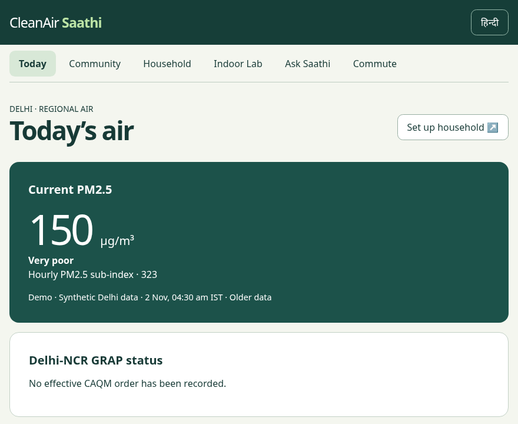
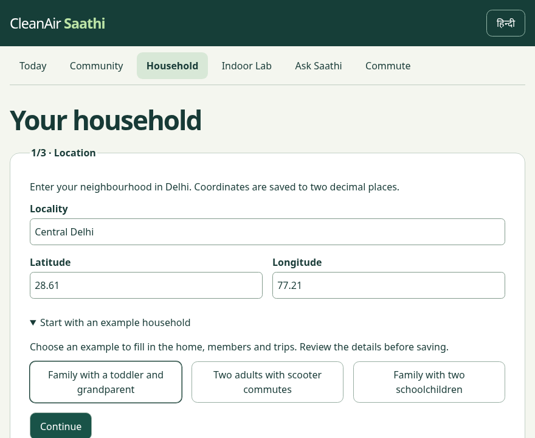
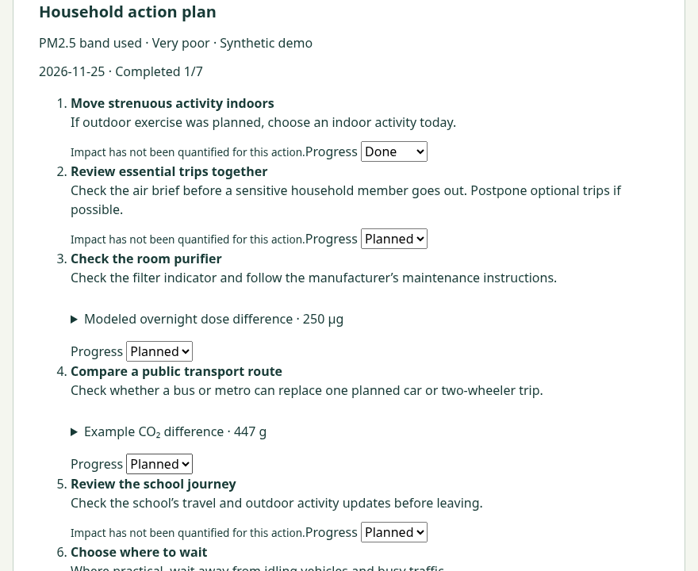
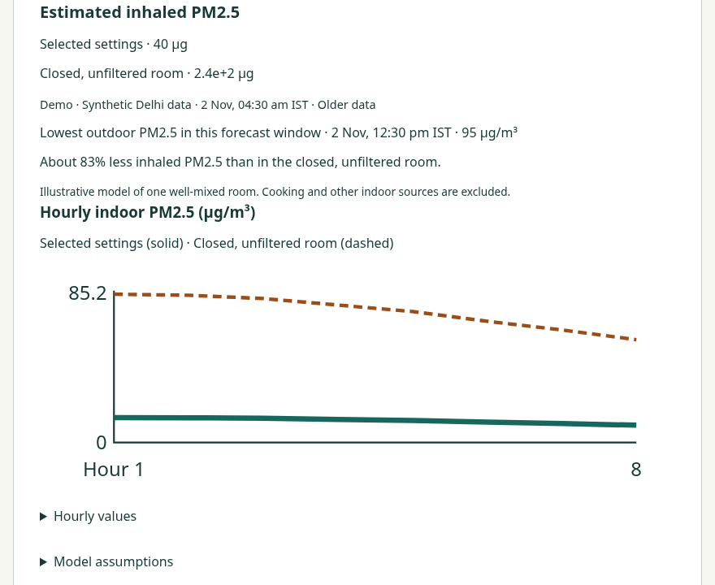
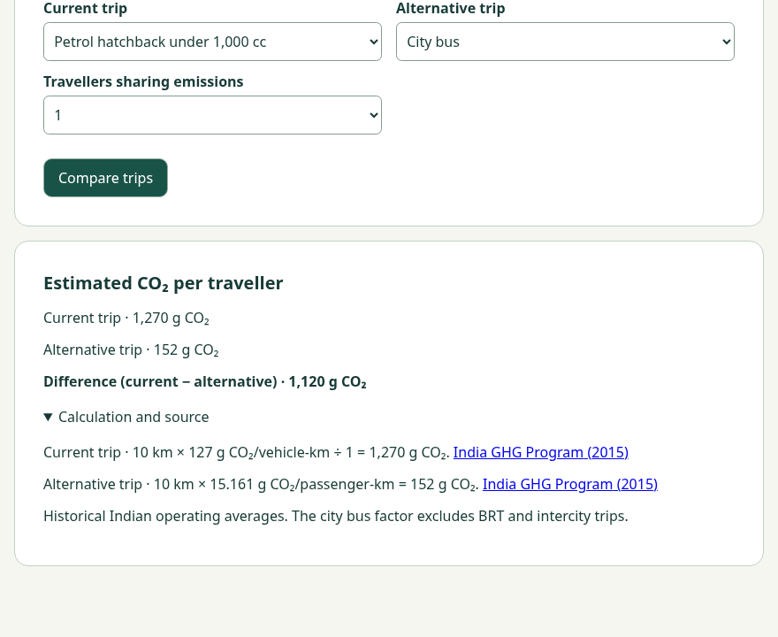
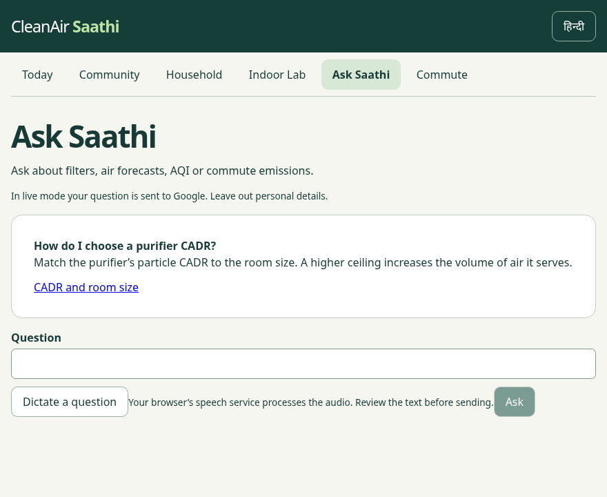
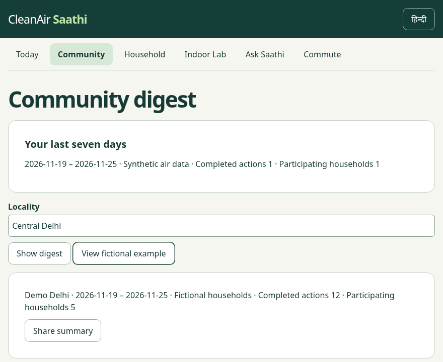

# CleanAir Saathi

CleanAir Saathi helps a Delhi household turn an air-quality forecast into a daily plan. Set up a household, compare room and commute choices, ask a question in Hindi or English, and track completed actions. Each air reading shows its source and timestamp. The PM2.5 band describes the particulate component of AQI. Exposure and CO₂ figures are modeled comparisons.

**[Watch the captioned app walkthrough (MP4)](docs/cleanair-walkthrough.mp4)**



[Local deployment](#local-deployment) · [Walkthrough](#walkthrough) · [Data modes](#data-modes-and-optional-services) · [Development and tests](#development-and-tests) · [Data and API reference](docs/data-and-api.md)

## Local deployment

Use **Git and Docker Compose v2**. On Windows, start Docker Desktop and open PowerShell in the folder where you keep projects. Compose runs all three services: the React dashboard served by nginx, the FastAPI backend and PostgreSQL with pgvector. The default demo works without external API keys after the images have been built.

**1. Clone the repository.** If you already have a checkout, open its root directory instead. It contains `compose.yaml`.

```sh
git clone https://github.com/risbh19/cleanair-saathi.git
cd cleanair-saathi
docker compose version
```

**2. Create the local configuration.** On the first run, copy the example and open the copy. On Windows PowerShell:

```powershell
Copy-Item .env.example .env
notepad .env
```

On macOS or Linux, run `cp .env.example .env` and open `.env` in your editor. Replace the example value of `POSTGRES_PASSWORD` with a password you choose **before the first start**. Keep `DATA_MODE=fixture` for the walkthrough. Keep the same password when restarting an existing database volume.

**3. Build, start and check the stack.** These commands work in PowerShell, bash and zsh.

```sh
docker compose up --build --wait
docker compose ps
```

Open the [dashboard](http://localhost:5173), the [interactive API docs](http://localhost:8000/docs) or the [health endpoint](http://localhost:8000/health). The health response for this setup is:

```json
{"status":"ok","data_mode":"fixture"}
```

**4. Stop and resume.** Run `docker compose down` to stop the services and keep the database volume. Run `docker compose up -d --wait` to resume. Open the same browser and dashboard address to return to the anonymous household. The browser holds its access token, while PostgreSQL holds its profile and plans.

| If you see this | What to check |
|---|---|
| Docker cannot connect to its daemon | Start Docker Desktop or the Docker Engine, then run `docker info`. |
| Compose asks for `POSTGRES_PASSWORD` | Check that the file is named `.env`, is next to `compose.yaml`, and has a non-empty password. |
| Port 5173 or 8000 is already allocated | Stop the other local process using that port and rerun Compose. |
| A service stays unhealthy | Run `docker compose ps -a` and `docker compose logs --tail=80 db backend frontend`. For an existing volume, verify that the database password matches the one used at initialization. |

## Walkthrough

The screenshots below come from a running local app using **synthetic Delhi air data** and the bundled reference answers. Start on **Today** to see the timestamp, source, PM2.5 band and 48-hour outlook. Use the language button in the header to switch between English and Hindi.

### 1. Create a household

Open **Household → Start with an example household → Family with a toddler and grandparent**. Choose **Continue** to review the room and purifier, then continue to members and commutes. Select **Save household**. You can edit any example field before saving.



### 2. Follow the daily plan

On **Today**, scroll to **Household action plan**. Expand a modeled comparison to inspect its assumptions. Set one action’s **Progress** to **Done**; the completion count updates and survives a reload. The first plan for a household is saved per Delhi date and data mode.



### 3. Compare indoor exposure

Open **Indoor Lab**, select **Use hourly Delhi forecast**, and choose **Compare settings**. The chart compares the selected room with the same room closed and unfiltered. Expand **Hourly values** for concentrations in µg/m³. The dose summary above the chart is the estimated mass inhaled over the whole scenario, in µg.



### 4. Compare a commute

Open **Commute**, choose the current and alternative modes, enter a one-way distance and select **Compare trips**. Expand **Calculation and source** to see the factors behind the estimate. The example compares a petrol hatchback with a city bus over 10 km for one traveller.



### 5. Ask a sourced question

Open **Ask Saathi** and try **“How do I choose a purifier CADR?”** The response includes the source used for the answer. Switch to Hindi and try **“फ़िल्टर कब बदलें?”** An unrelated question exercises the insufficient-evidence response.



### 6. View and share weekly progress

Open **Community** to see the household’s last seven days. Enter a locality and choose **Show digest**. A real locality summary appears after at least five distinct households have completed actions; each modeled impact total also needs five contributing households. On a fresh install, **View fictional example → Share summary** lets you try sharing immediately. The example stays separate from real totals.



## Data modes and optional services

Edit the relevant settings in `.env`, then run `docker compose up -d --wait` to apply them.

| Setting | Behavior |
|---|---|
| `DATA_MODE=fixture` | Reproducible synthetic air and weather data used throughout the walkthrough. |
| `DATA_MODE=replay` | Archived Delhi model data from January 2025 with source and retrieval details. |
| `DATA_MODE=live` | Fetches regional air and weather from Open-Meteo. An optional `OPENAQ_API_KEY` enables nearby station observations. The first live request may return 503 while the cache fills. |
| `LLM_MODE=reference` or `replay` | Runs Ask Saathi and plan selection using reviewed content or bundled selection fixtures. |
| `LLM_MODE=live` | Requires a server-side `GEMINI_API_KEY` and supported `GEMINI_MODEL`. Optional pgvector retrieval also requires an embedding model and index preparation. |

[Provider configuration and index preparation](docs/data-and-api.md#ask-saathi-and-plan-selection) · [Offline phone demo, school-run groups and optional Telegram delivery](RELEASE.md) · [Privacy and security](SECURITY.md)

## Development and tests

For frontend changes, keep the Compose stack running. In another terminal, use Node 22.12+ and start Vite on **5174** so it can proxy API calls to the backend on port 8000 while the production dashboard stays on 5173.

```sh
cd frontend
npm ci
npm run dev -- --port 5174
```

Open [the development dashboard](http://localhost:5174). A different browser origin has its own anonymous household token. Use `npm run build` in `frontend/` to check the production bundle.

For backend tests, start at the repository root with Python 3.12:

```sh
python -m venv .venv
```

Activate with `.\.venv\Scripts\Activate.ps1` in PowerShell or `source .venv/bin/activate` in bash/zsh, then run:

```sh
python -m pip install -r backend/requirements-dev.txt
python -m unittest discover -s backend/tests -v
```

Database integration tests require `TEST_DATABASE_URL` pointing to a **disposable** PostgreSQL database. The pgvector integration test also needs the extension available. CI provisions the database, applies migrations, checks persistence across a restart, builds the dashboard and exercises the mobile flow in Chrome. See the [verification and demo guide](RELEASE.md) and [CI workflow](.github/workflows/check.yml).
