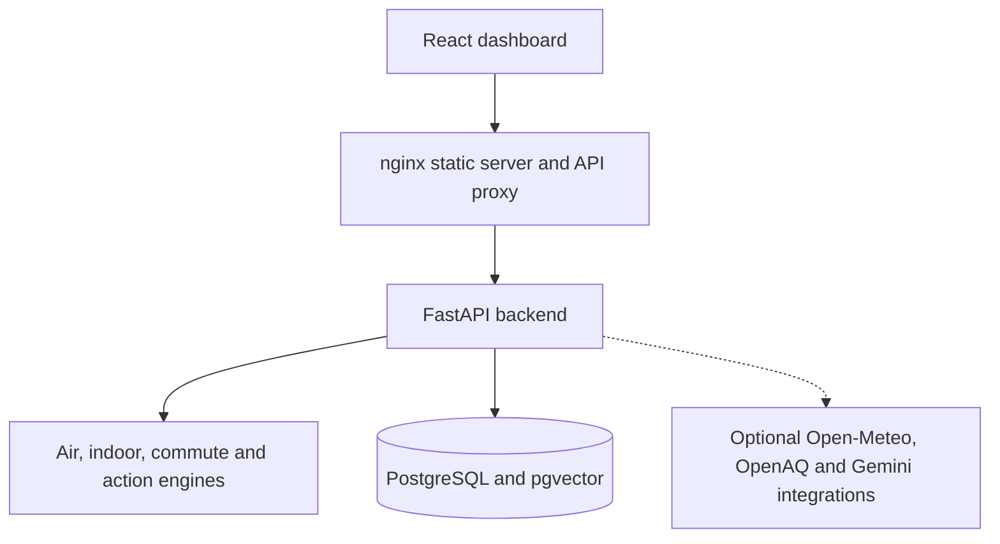

# CleanAir Saathi

**Household air-quality decisions, explained.**

[](https://github.com/risbh19/cleanair-saathi/actions/workflows/check.yml)


CleanAir Saathi helps Delhi households understand local air conditions, choose practical daily actions, and compare indoor and travel scenarios. It brings air-quality information, household context, calculation engines, and cited guidance into one bilingual dashboard.


*Home dashboard in fixture mode. The displayed 150 µg/m³ reading is synthetic demonstration data.*

[Overview](#overview) · [Capabilities](#capabilities) · [Architecture](#architecture) · [Quick start](#quick-start) · [AI and data modes](#ai-and-data-modes) · [Development](#development)

## Overview

A pollution reading becomes useful when a household can connect it to everyday choices: where to spend time, how to use a purifier, and how different travel options compare.

CleanAir Saathi supports these decisions through three connected parts:

- **Understand the conditions.** View current PM2.5, a 48-hour forecast, weather information, source timestamps, and recorded GRAP orders.
- **Compare practical choices.** Use household details to select daily actions, estimate indoor exposure under different room settings, and compare commute emissions.
- **Keep track.** Save action progress, view a private weekly summary, and access locality summaries subject to participation thresholds.

Daily action eligibility uses the household profile and current PM2.5 band. Forecasts are available separately and can supply hourly outdoor concentrations to Indoor Lab.

## Capabilities

| Capability | What it provides |
|---|---|
| Air and weather dashboard | Current PM2.5, its component sub-index band, a 24-hour mean when enough observations exist, hourly forecasts, and freshness indicators |
| Household profiles | Room dimensions, purifier CADR, cooking fuel, household members, sensitivity flags, and commute details |
| Daily action plans | Up to seven eligible actions from a reviewed bilingual catalogue, persisted by household, Delhi date, and data mode |
| Indoor Air Lab | A room model comparing selected settings with a closed, unfiltered baseline, including estimated inhaled PM2.5 and purifier sizing |
| Commute comparisons | Per-passenger CO₂ estimates for supported car, scooter, auto-rickshaw, and bus scenarios using stored India-specific factors |
| Ask Saathi | Hindi and English answers from reviewed passages, with citations or an explicit insufficient-evidence response |
| Community progress | Private weekly activity, locality summaries with a five-household minimum, and opt-in school-run matching |
| Offline access | A cached application shell and a bundled, explicitly labelled example dataset |

The interface supports **English and Hindi**. GRAP orders are entered by an operator through a protected endpoint, with the effective order and source shown in the dashboard.

## Architecture



| Layer | Technology | Responsibility |
|---|---|---|
| Interface | React 19, Vite 7, service worker | Dashboard, bilingual forms, comparison charts, and offline shell |
| Application | Python 3.12, FastAPI, Pydantic, Uvicorn | API routes, validation, household authorization, and calculation engines |
| Storage | PostgreSQL 16, pgvector, psycopg | Profiles, plans, progress, emission factors, GRAP orders, and optional passage embeddings |
| Delivery | Docker Compose, nginx | Local service orchestration, static assets, and API proxying |
| Verification | unittest, Playwright, axe-core, GitHub Actions | Backend checks, database integration, mobile browser flows, and accessibility checks |

Air and weather snapshots are cached in process. Household and plan data persist in PostgreSQL. The browser stores an anonymous session token and language preference.

## Quick start

Install **Git** and **Docker with Compose v2**. On Windows, start Docker Desktop before running the commands below.

```sh
git clone https://github.com/risbh19/cleanair-saathi.git
cd cleanair-saathi
```

Create the local configuration:

```powershell
# Windows PowerShell
Copy-Item .env.example .env
notepad .env
```

```sh
# macOS or Linux
cp .env.example .env
```

Set `POSTGRES_PASSWORD` to a local password before the first start. Keep `DATA_MODE=fixture` to use the bundled example data. Retain the same password when restarting an existing database volume, and keep `.env` out of version control.

```sh
docker compose up --build --wait
docker compose ps
```

| Service | Address |
|---|---|
| Dashboard | [localhost:5173](http://localhost:5173) |
| Interactive API documentation | [localhost:8000/docs](http://localhost:8000/docs) |
| Health endpoint | [localhost:8000/health](http://localhost:8000/health) |

The services bind to the local machine. Run `docker compose down` to stop the stack while retaining its database volume, or `docker compose up -d --wait` to resume it. The default fixture setup needs no external API keys after the images have been built.

## AI and data modes

Air-data settings and AI settings are independent. Configure them in the private `.env` file and apply changes with `docker compose up -d --wait`.

| Setting | Behavior |
|---|---|
| `DATA_MODE=fixture` | Bundled synthetic air and weather series for reproducible local use |
| `DATA_MODE=replay` | Archived Delhi model data from January 2025, with source metadata |
| `DATA_MODE=live` | Regional CAMS air-quality and weather feeds through Open-Meteo; an optional `OPENAQ_API_KEY` enables nearby station readings |
| `LLM_MODE=reference` | Reviewed passage lookup and catalogue ordering without AI-provider calls |
| `LLM_MODE=replay` | Bundled deterministic selection fixtures, with reference fallback |
| `LLM_MODE=live` | Optional Gemini selection using a server-side `GEMINI_API_KEY` and configured `GEMINI_MODEL` |

On `main`, Gemini can order eligible action IDs and select reviewed passage IDs. Optional embeddings add semantic retrieval through pgvector. Answer text, source URLs, action eligibility, and calculation results remain controlled by the application. Invalid or unavailable provider responses retain the reference behavior.

Live chat questions are sent to Google; users should leave out personal details. See the [AI configuration and index preparation reference](docs/data-and-api.md#ask-saathi-and-plan-selection) for environment variables and optional retrieval setup.

## Model assumptions and privacy

- **Air-quality scope:** the app covers a Delhi region. Its PM2.5 sub-index describes one pollutant component, rather than the official multi-pollutant overall AQI. Regional model values can differ from nearby station observations.
- **Indoor estimates:** the model assumes one well-mixed room at hourly equilibrium. Indoor sources such as cooking are excluded, and default air-exchange and breathing rates are illustrative.
- **Commute estimates:** comparisons use published operating emission factors and scenario assumptions. They are not a full vehicle lifecycle assessment.
- **Action progress:** completion records participation. Exposure and CO₂ figures are modeled comparisons, not measured savings.
- **Access and privacy:** anonymous bearer tokens identify households; the database stores token digests. Coordinates are rounded to two decimal places, and locality summaries require at least five contributing households.

Calculation methods, data sources, API examples, and configuration details are documented in [docs/data-and-api.md](docs/data-and-api.md). Security information is available in [SECURITY.md](SECURITY.md).

## Development

Run backend checks from the repository root with Python 3.12. Activate a virtual environment, then install the development dependencies:

```sh
python -m pip install -r backend/requirements-dev.txt
python -m unittest discover -s backend/tests -v
```

Database integration tests require `TEST_DATABASE_URL` pointing to a disposable PostgreSQL database. The pgvector check also requires the vector extension.

For frontend development, keep the Compose stack running and start Vite on a separate port:

```sh
cd frontend
npm ci
npm run dev -- --port 5174
```

Use [localhost:5174](http://localhost:5174) for development and `npm run build` for the production bundle. On Windows, `npm.cmd` can be used when PowerShell blocks `npm.ps1`.

The [CI workflow](.github/workflows/check.yml) checks backend behavior, database migrations and persistence, Docker startup, engine coverage, and mobile browser flows. [Dependency advisories](.github/workflows/dependency-review.yml) run separately on a schedule.
